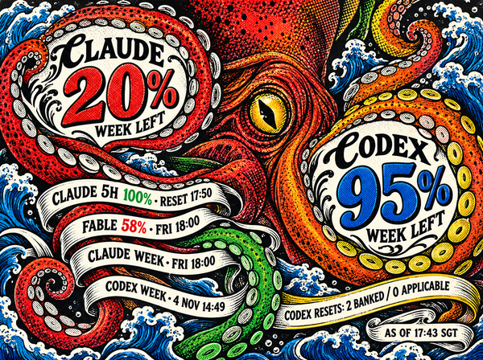
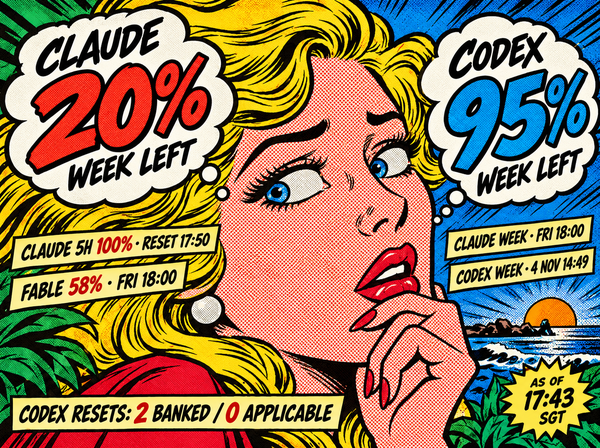
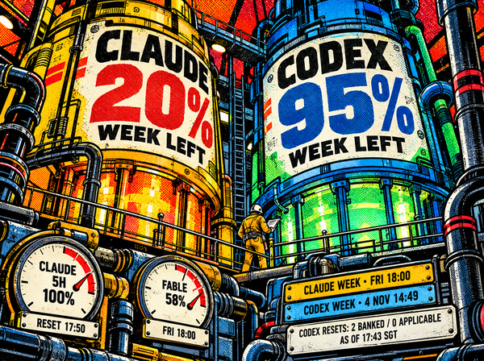
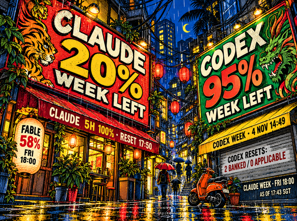
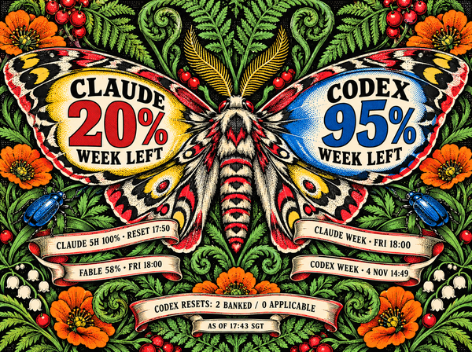
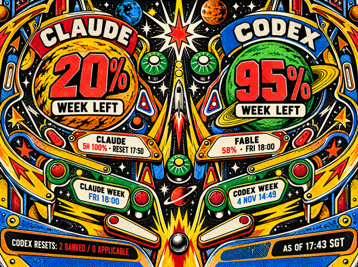

# Inky Claude/Codex Usage Display

Claude and Codex usage, turned into a little desk artwork.

A Raspberry Pi Zero 2 W and a seven-colour e-ink display show your remaining
allowance and reset times. The numbers live inside the illustration: speech
balloons, tentacle coils, reactor tanks, shop signs, moth wings, and a pinball playfield.

| Budget Kraken | Pop Comic |
| --- | --- |
| [](designs/integrated-v2/02-budget-kraken-concept.png) | [](designs/integrated-v2/01-pop-comic-concept.png) |
| **Reactor Room** | **Night Market** |
| [](designs/integrated-v2/03-reactor-room-concept.png) | [](designs/integrated-v2/04-night-market-concept.png) |
| **Quota Moth** | **Cosmic Pinball** |
| [](designs/integrated-v2/05-quota-moth-concept.png) | [](designs/integrated-v2/06-cosmic-pinball-concept.png) |

*Digital concept mockups with frozen example readings; click any image for the full
600 × 448 view. The live display draws current values into matching clean artwork
plates. Physical e-ink colours differ from these RGB previews.*

## On the desk

- **Real usage at a glance.** Claude and Codex remaining allowance, session and scoped
  limits, reset times, and Codex reset-credit availability.
- **Six artworks that rotate automatically.** Each usage refresh advances to the
  next composition, with live text drawn into the artwork's own shapes and surfaces.
- **A slower kind of screen.** The Pi polls usage every ten minutes. A full refresh takes
  about 34 seconds, and the image stays visible when the display loses power.
- **Honest about freshness.** Old observations are marked stale; missing data stays
  missing. Collection and button controls run on the Pi, independently of the Mac.

The display's four buttons choose the artwork:

| A | B | C | D |
| --- | --- | --- | --- |
| Previous + lock | Next + lock | Random + resume rotation | Budget Kraken + lock |

Rotation is enabled by default and follows usage updates or freshness changes.
A/B lock the artwork while its usage figures continue updating; C picks another
random artwork and resumes rotation. Presses during a refresh select what appears
next. The latest selection and rotation/lock mode survive a restart.

## Make one

The tested hardware is a **Raspberry Pi Zero 2 W** and the original **Pimoroni Inky
Impression 5.7-inch, seven-colour, 600 × 448** display. This panel is discontinued.
The code also recognizes Pimoroni's current Spectra 6 models, adapting image size,
colour palette, and button wiring automatically from the display's EEPROM.

| Pimoroni display | Resolution | Colours | Project validation |
| --- | --- | --- | --- |
| [Original Inky Impression 5.7-inch](https://shop.pimoroni.com/products/inky-impression-5-7) — discontinued | 600 × 448 | 7 | Tested on the physical device |
| [Inky Impression 4.0-inch](https://shop.pimoroni.com/products/inky-impression?variant=56039376912763) | 600 × 400 | 6 | Experimental; rendering and driver conversion tested |
| [Inky Impression 7.3-inch](https://shop.pimoroni.com/products/inky-impression?variant=55186435244411) | 800 × 480 | 6 | Experimental; rendering and driver conversion tested |
| [Inky Impression 13.3-inch](https://shop.pimoroni.com/products/inky-impression?variant=55186435277179) | 1600 × 1200 | 6 | Experimental; rendering and driver conversion tested |

The current models have not been tested on physical hardware for this project.
Artwork keeps its proportions, with margins where needed. The original 5.7-inch
output is preserved. Other legacy seven-colour sizes are not supported.

The Pi collects usage directly from CLIProxyAPI over HTTPS, renders the artwork,
and drives the display. A systemd timer runs every ten minutes; the Mac is only
needed for initial setup. Vendor OAuth tokens stay on the proxy. The Pi stores
its management credential in protected configuration outside the repository.

**[Hardware, installation, and operations →](docs/hardware-and-operations.md)**

You can try image generation locally without hardware or an account:

```sh
uv sync
uv run python -m inky_frame sample /tmp/inky-preview.png

# Preview a current six-colour model instead
uv run python -m inky_frame sample /tmp/inky-spectra.png --profile spectra6-7.3

# Render all six artworks at all four resolutions using synthetic usage
uv run python -m scripts.render_previews
open state/multi-display/previews/index.html
```

The [visual council review](docs/visual-council-review.md) records the typography
corrections, independent verdicts, and how to reproduce all 312 validation images.

## The artwork

The project began with twelve illustration studies and evolved into these six
full-screen compositions. The original mockups, higher-resolution masters, clean
plates, seven-colour proofs, and exact generation prompts are all preserved.

- [Six integrated compositions and prompts](designs/integrated-v2/README.md)
- [Clean artwork plates used by the live renderer](assets/live/README.md)
- [Earlier design study and rendering notes](docs/hardware-and-operations.md#usage-display-design-study)

## License

Project code is [MIT licensed](LICENSE). Fonts retain their OFL licenses, and
manufacturer references retain their original rights. See [third-party notices](THIRD_PARTY.md).
