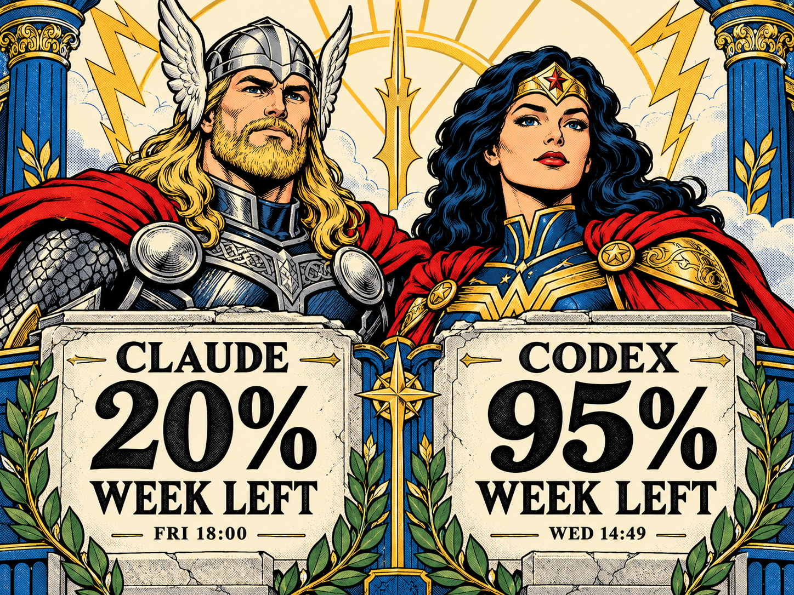
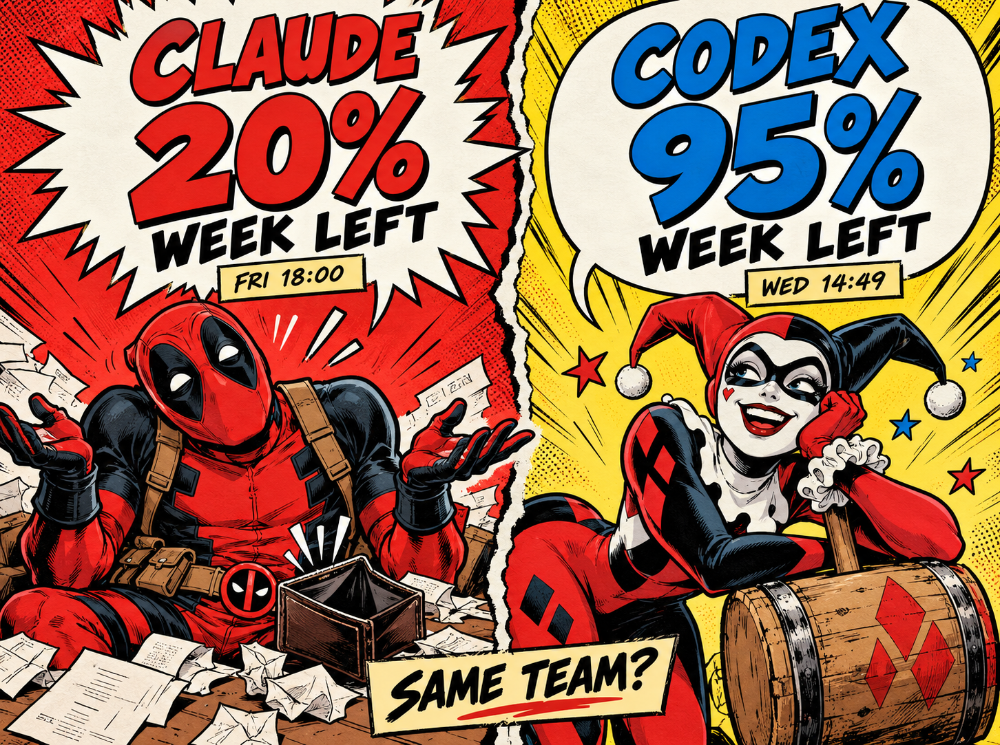
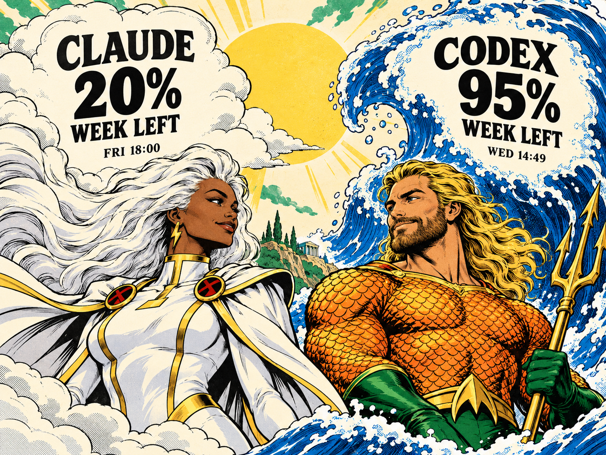
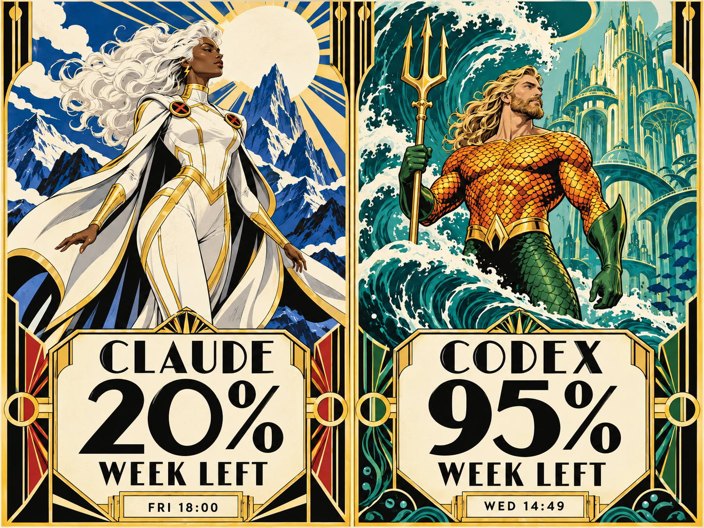
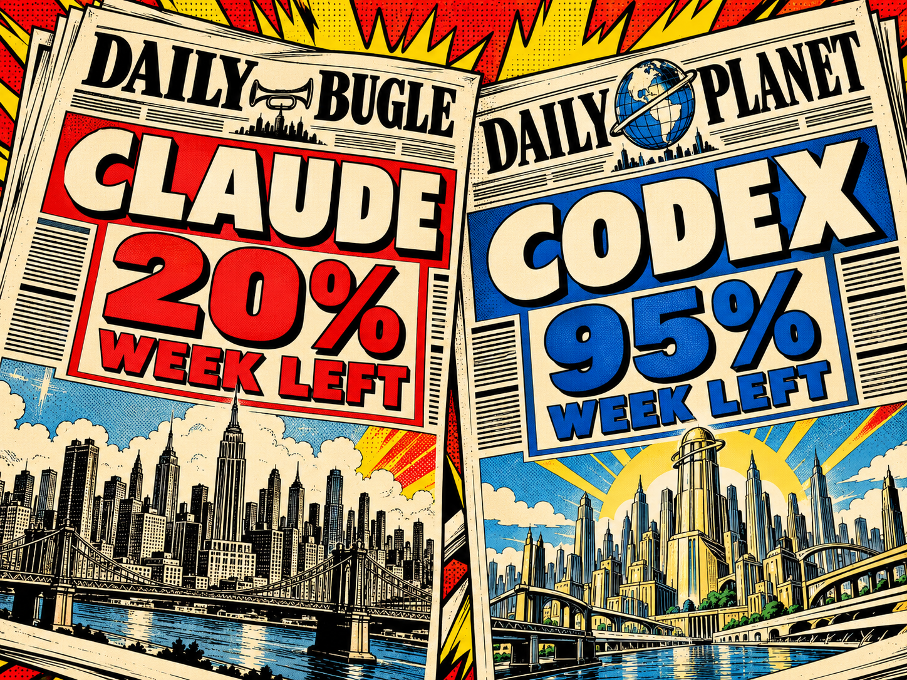
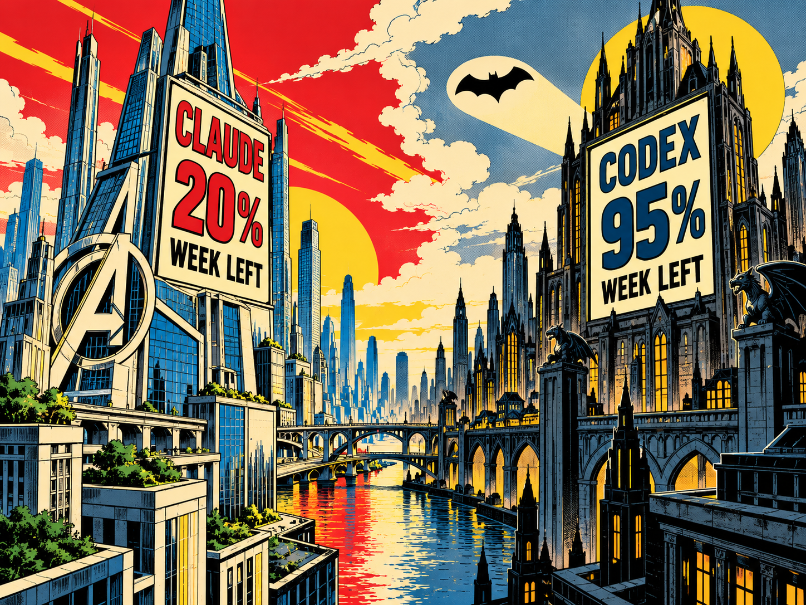

# Marvel versus DC — artwork study

**Six completed samples:** four character-led compositions and two environments
from the Marvel/DC worlds. The final selection mixes heroic portraits, comic
banter, elemental illustration, an Art Deco diptych, newspaper headlines and
architectural signs. All six originals are saved in this directory.

## Completed artwork

| 01 / Gods of Thunder | 02 / Fourth Wall |
| --- | --- |
|  |  |
| Thor × Wonder Woman: heroic portraiture, carved stone panels and gold/cobalt framing. | Deadpool × Harley Quinn: expressive comic banter and oversized speech balloons. |
| **03 / Sky & Sea** | **04 / Tide & Tempest** |
|  |  |
| Storm × Aquaman: organic cloud and sea-foam lettering. | Storm × Aquaman: full-figure artwork and large geometric title panels. |
| **05 / Headline Battle** | **06 / Twin Skylines** |
|  |  |
| Daily Bugle × Daily Planet: the numbers become the headlines. | Avengers Tower × Gotham: the figures are part of the architecture. |

Open [the local comparison gallery](index.html) to inspect all six images at up to
600 CSS pixels wide. Native generated files are preserved; browser scaling is
not an exact 600 × 448 export or a physical-size simulation.

The gallery uses sample numbers 1–6. Filenames retain their original concept IDs
so generation provenance stays stable; [selected.json](selected.json) maps the
final samples to files, pairings and prompt sources.

## Sample data and production status

These are generated comic fan-art mockups with fixed example values from the
[28 October 2026 snapshot](../data/snapshot.json): Claude **20%** weekly allowance
remaining and Codex **95%**. The four character samples include Friday 18:00 and
Wednesday 14:49 reset captions respectively, in Asia/Singapore; the two environment
samples focus on the headline balances. These are historical examples, not
current usage. `WEEK LEFT` means weekly allowance remaining.

Colours are RGB concept colours, not a validated seven-ink palette. None of these
images is installed on the Pi. Clean plates, dynamic text, additional usage and
freshness states, palette conversion and physical testing remain production work.

## Prompts and theme controls

All images were generated with the **built-in image_gen tool**. Exact prompts for
the selected samples are retained in:

- [Original briefs](prompts.json): Fourth Wall.
- [Revised portrait briefs](revised-prompts.json): Gods of Thunder.
- [Additional pairings](additional-prompts.json): Sky & Sea.
- [Alternate compositions](variant-prompts.json): Tide & Tempest.
- [Environment studies](environment-prompts.json): Headline Battle and Twin Skylines.

The generator rejected several other directions. Their briefs and request IDs
remain in [generation.json](generation.json) and
[additional-generation.json](additional-generation.json); no images exist for
those rejected attempts and they are not part of the final selection. We expanded
the composition types to complete the set rather than requiring six unique casts.
No alternate image backend was used.

The [theme-control direction](../../docs/artwork-themes.md) records the intended
D-button switch between Original, Street Fighter, and future themes. A/B/C and
automatic rotation must stay within the selected theme. The user chose to finish
the artwork mockups first and implement theme switching in the next round.
