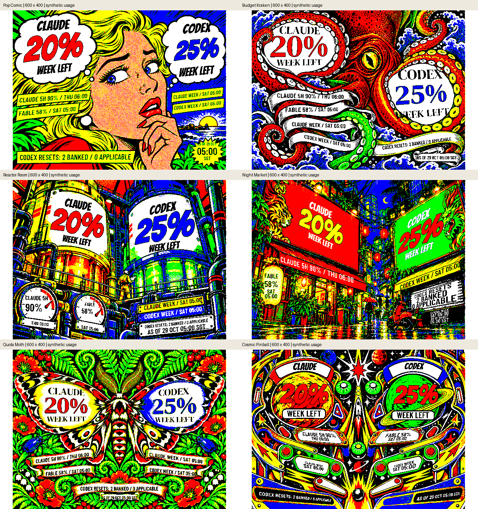

# Visual council review — 29 October 2026

**Final judgment: PASS from all three independent reviewers.** The council used
only `gpt-6-astra` and `gpt-6.1-sol`, with separate composition, typography, and
data-semantics assignments. Reviewers inspected rendered indexed PNGs and native
pixel crops, not just source code or thumbnails.

## What changed

| Finding | Correction |
| --- | --- |
| Long model names reduced the percentage to specks | Abbreviate the name visibly; retain the full percentage. Stack name/value in the narrow gauge and lantern. |
| Stale/unavailable headings collided with artwork or lost serif strokes | Separate provider and health rows, use Barlow for health, and reserve more space when no percentage is available. |
| Reactor gauge text crossed rims and fixed needles | Give labels and values separate safe areas, ending before the needle hubs. |
| Reactor reset text was black on blue | Use white text on the existing blue plaque. |
| Night Market credits crossed the shutter lintel and slats | Inset the lettering within the shutter, with a light backing and separate banked/applicable rows. |
| Night Market scope and freshness details were too small or noisy | Stack the lantern facts and give the existing lower sign a dark inset with explicit reset/observation rows. |
| Pinball's small blue reset text became dense outlines | Use black unoutlined dates and allocate more height to their rows. |
| Pinball health text touched the curved title border | Raise and inset the title text without shrinking it further. |
| Kraken reset digits touched the ribbon boundary | Shorten and lift that text quadrilateral. |
| Multiple model scopes inherited the first scope's reset | Show the most restrictive scope with its own reset and a visible `+N` marker for other scopes. |
| Reported Codex session exhaustion was hidden | Include the 5-hour remaining value in its supporting surface while retaining weekly allowance; label the weekly reset `7D`. |
| Missing-weekly fallback could mislabel a scope reset as a session reset | Derive the reset label from the actual headline window. |
| Invalid future observations appeared in the shared footer | Exclude those timestamps from the observation time while retaining unavailable provider state. |

These are text and data-presentation corrections within the six approved scenes.
The source plates, palette ordering, hardware detection, buttons, collector, and
refresh serialization are unchanged. The existing compact display is not a
complete reset calendar: when Codex weekly and session quotas coexist, both
remaining allowances are visible, but the supporting date is the weekly reset.



## Review coverage and evidence

The first round covered all 120 original fixture images collectively and failed
on concrete text-placement, contrast, and data-attribution defects. After the
first remediation, the second round covered all 288 images collectively.
Typography passed; composition and semantics identified remaining gauge/ribbon/
title collisions. Those conditions were corrected and received focused final
acceptance, including the newly added scope-without-weekly case.

The final reproducible matrix contains **312 images**:

- Six artworks × four profiles × five original scenarios = 120.
- Six artworks × four profiles × eight additional scenarios = 192.
- The added scenarios cover mixed health, expired providers, passed reset times,
  multiple scopes and exhausted Codex session, absent windows, absent session and
  scope, invalid future observations, and a scope headline without aggregate weekly usage.

Of the final images, 144 are pixel/palette-identical to the fully reviewed second
round, 144 contain the final geometry corrections and were rechecked across all
states/sizes, and 24 are the new fallback case reviewed by the semantics member.
Reviewer counts overlap: final composition inspected 104 frames, typography 64,
and semantics 40 full frames plus additional native crops. No reviewer claimed
to have individually inspected the entire matrix.

All three final verdicts are **PASS**, with no remaining mandatory raster fixes.
Small supporting labels still require close reading, especially on the 4-inch
panel. Physical pigment contrast and readability under desk lighting remain
separate from these software proofs; the three newer display sizes remain
experimental until physically tested.

## Reproduce

```sh
uv run python -m scripts.render_previews --all-states
uv run python -m scripts.render_previews --all-states \
  --fixtures tests/fixtures/render-edge-snapshots.json \
  --output state/multi-display/edges
```

Each output directory contains native PNGs, an HTML gallery with every selected
scenario, and `report.json` recording dimensions, pixel/palette hashes, fixture
hash, timings, and Pillow version. All inputs are synthetic; no account or Pi is
needed. Original and final council evidence is retained locally under ignored
`state/council/`, including independent reports and the comparison manifest.

## Validation

- 147 tests pass; Ruff and whitespace checks pass.
- All 312 PNGs validate against their target dimensions, indexed palette and
  allowed colour indices.
- The original 5.7-inch palette is unchanged in all 30 baseline cases. Typography
  deliberately changes 26 cases; four remain pixel-identical. The old golden
  fixture is retained; `reviewed-render-hashes.json` records the corrected output.
- An isolated Pi candidate rendered 18 original-size cases and a 1600×1200 case
  using its existing Pillow 11.1.0, in 88.16 seconds with peak RSS 75.4 MiB.
- The corrected renderer was deployed with the current Night Market selection
  preserved. Its refresh completed at 10:45:38 +08 in 34.17 seconds; saved pixels,
  palette and successful-frame digest match an independent render of the latest
  on-device usage. The gallery and collection timer remain active. The existing
  runtime and selection are backed up under `/tmp/inky-council-20261029/` on the Pi.
- The HTML palette detector produced three advisory findings about the preview
  gallery's chrome, not the raster artwork. Its parser fallback cannot establish
  raster contrast; actual PNG inspection supplied that evidence.

Questions were skipped because MC had already authorized remediation of all
findings and final review. Review scope and artwork identity remained fixed.
